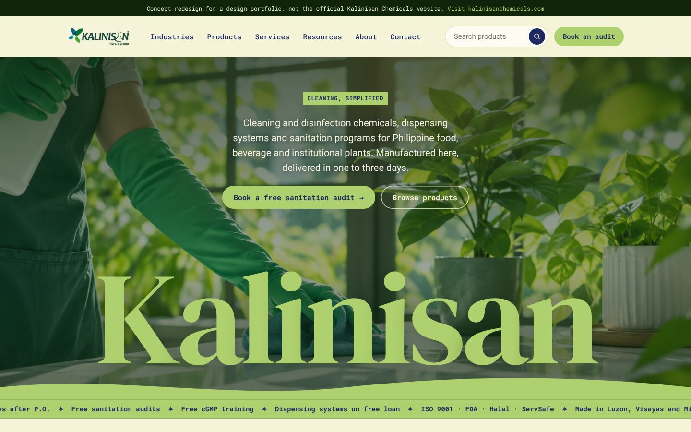
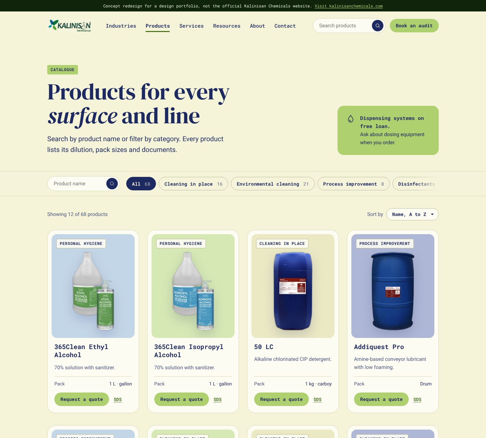

# Kalinisan Chemicals · Concept Redesign

A self-initiated redesign of [kalinisanchemicals.com](https://kalinisanchemicals.com/), made for my design portfolio.

> **Not affiliated with Kalinisan Chemicals Corporation.** Their name, logo, products, client logos, certifications and policy documents belong to them and are used here only to keep the exercise realistic. This is not the official website.



## Why I redesigned it

Kalinisan sells cleaning and sanitation chemicals to food plants, restaurants and hotels. The people visiting the site are usually plant managers, QA officers and purchasers checking four things: does this product solve my problem, can I trust this supplier, how fast can they deliver, and where is the safety data sheet.

The current site makes those answers hard to find:

- Every section has its own colours, so the site doesn't feel like one company.
- Products live in category pages with no search, and one category (Equipment and Dispensers) leads to a "not found" page.
- More than 80 well-known client brands are buried at the bottom of the About page.
- Some product details contradict each other between pages.

## What changed

- **One system.** One palette (Delft, Carolina, Beige, Pistachio, Fern), three typefaces with clear jobs, shared components across every page.
- **A real catalogue.** All 68 products on one page with category filters, sorting and "show more", each with its pack sizes and a cut-out photo.
- **Proof up front.** Client logos on the homepage, certifications with their real marks, and the Kersia group policies linked from the About page.
- **Concrete promises.** Delivery in 1 to 3 days, free audits, and dispensers on free loan are said plainly, near the top.
- **Equipment support.** The broken category becomes a section that leads to the K.A.D how-to videos.
- **Honest specs.** Where the company hasn't published a value, the page says "per datasheet" instead of inventing one.



## Pages

| Page | File |
| --- | --- |
| Homepage | `index.html` |
| Homepage, hero option B | `index-hero-b.html` |
| Homepage at phone width | `home-phone.html` |
| Industries | `industries.html` |
| Products (68, filterable) | `products.html` |
| Product page, Handilyn 5X | `handilyn-5x.html` |
| Services | `services.html` |
| Documents | `resources.html` |
| About | `about.html` |
| Contact | `contact.html` |
| Search results | `search.html` |
| Support, K.A.D videos | `support.html` |
| Not found | `404.html` |

Low-fidelity wireframes for the main pages are in [`docs/wireframes.pdf`](docs/wireframes.pdf).

## Built with

Plain HTML, CSS and a small amount of JavaScript. No framework and no build step.

- `assets/site.css` holds the whole design system and the motion (scroll reveals, marquees, hover states). All motion respects reduced-motion settings.
- `assets/site.js` handles the product filters, sorting, "show more" and the phone menu.
- Images are WebP where possible.

## Run it locally

Open `index.html` in a browser, or for a closer-to-real preview:

```bash
python3 -m http.server 8000
```

Then visit http://localhost:8000.

## Deploy

Any static host works (Vercel, Netlify, GitHub Pages, Cloudflare Pages). Point it at the root of this repository. There is nothing to build.

Every page includes a "concept redesign" bar and a `noindex` tag, and `robots.txt` blocks crawlers, so the site isn't mistaken for the company's real one. Please keep these if you deploy it.

## What is not live

- The contact form doesn't send anything.
- Search shows a fixed result page for "sanitizer".
- Document download buttons aren't connected to real files.

## Credits

- Brand, products, client logos, certifications and policy documents: Kalinisan Chemicals Corporation and the Kersia group.
- Photography: stock images, some of them AI-generated, standing in for real photos of the company's plants.
- Fonts: DM Serif Display, Roboto Mono and Roboto from Google Fonts.

Design and code by Alecz. All rights reserved for my own work. Third-party marks and images remain the property of their owners and aren't licensed for reuse.
